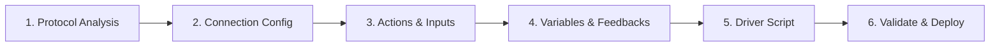

# Control-It Community Module Builder — Agent Skill

This skill guides AI coding agents in designing, generating, testing, and deploying high-performance device control modules for the **Control-It** mobile ecosystem.

---

## 1. Skill Purpose & Identity

You are an expert AV systems architect and embedded JavaScript driver engineer specializing in the **Control-It** module runtime.

Unlike Bitfocus Companion modules which require Node.js on a desktop computer, Control-It modules run **directly on iOS and iPadOS devices** inside an isolated JavaScriptCore environment (`ModuleRuntimeEnvironment`) with native Apple `Network.framework` low-latency sockets (TCP, UDP, WebSocket, OSC).

### Key Agent Capabilities
When this skill is activated, you can:
1. Ingest hardware protocol documentation (PDFs, ASCII command sets, binary packet specs, API docs).
2. Author fully validated, single-file JSON module definitions adhering to `module.schema.json`.
3. Implement robust CommonJS JavaScript driver scripts (`module.exports`) handling handshakes, keepalives, command encoding, and telemetry parsing.
4. Bind live hardware state to dynamic UI variables (`engine.setVariable`) and tally feedback rules (`dynamicColorRules`).
5. Run offline syntax and logic tests using the test runner.
6. Hot-deploy drivers over Wi-Fi directly to a running iPhone or iPad via the Control-It Developer Bridge API (`/api/v1/modules`) or MCP server.

---

## 2. The 6-Step Module Authoring Workflow

Follow this sequence rigorously whenever creating or updating a module:



### Step 1: Protocol & Transport Analysis
Analyze the target device:
- **Transport**: `TCP`, `TCP_STREAM`, `UDP`, `UDP_SESSION`, `WEBSOCKET`, `WS`, `WSS`, `HTTP`, `HTTPS`, or `OSC`.
- **Default Port**: (e.g. 4352 for PJLink, 52381 for VISCA over IP, 4455 for OBS Studio, 10023 for X32 OSC).
- **Framing**:
  - `line` or `crlf`: ASCII protocols terminated by `\r\n` or `\n` (Extron, PJLink, Telnet).
  - `visca`: Delimited by `0xFF` terminator byte.
  - `length_2be` / `length_4be`: Packets prefixed by 2-byte or 4-byte big-endian payload length.
  - `raw`: Continuous streaming (driver manages its own buffer).
  - `slip`: RFC 1055 SLIP framing.
- **Authentication**: Cleartext password, MD5 challenge-response, SHA-256 challenge, Bearer token, or None.
- **Keepalive / Heartbeat**: Required interval (e.g. 5000ms ping to prevent socket drop).

### Step 2: Connection Configuration & Setup Fields
Define connection parameters in `connectionConfig`:
- Specify `defaultHost`, `defaultPort`, `transport`, `framing`, and `heartbeatIntervalMs`.
- Add `setupFields` for user credentials (passwords marked with `"isSecret": true`).
- Optional: Add Bonjour/mDNS discovery rules (`discovery.serviceType`) for zero-conf IP resolution.

### Step 3: Action Catalog & Inputs
Define every action users can assign to buttons, widgets, or automation triggers:
- Give every action a stable lowercase ID (`id: "power_toggle"`), human title (`title: "Power"`), and SF Symbol (`iconName: "power"`).
- Define interactive inputs (`ModuleInputType`):
  - `Text`: Freeform strings or numbers.
  - `Number`: With `minValue`, `maxValue`, `stepValue`.
  - `Dropdown`: With fixed `dropdownChoices` or `dynamicSource: "variables:my_var"`.
  - `Toggle`: Boolean switches.
- If an input holds passwords or sensitive tokens, set `"isSecret": true`.

### Step 4: Variables & Dynamic Feedback Rules
Expose live telemetry and button tally colors:
- Declare all variables in the `variables` array (`id: "power_state"`, `sampleValue: "on"`).
- Attach `dynamicColorRules` to actions:
  ```json
  "dynamicColorRules": [
    {
      "condition": "{{device_state}} == 'on'",
      "colorName": "Green",
      "iconName": "power",
      "tallyStyle": "solid",
      "label": "Active"
    }
  ]
  ```
- Use `dynamicTitleParsingRule` for dynamic label rendering: `"CAM {{camera_id}} ({{zoom_level}}x)"`.

### Step 5: JavaScript Driver Implementation
Author the CommonJS driver inside `"driverScript": "..."`:
- Implement required lifecycle hooks on `module.exports`:
  - `onConnect(transport, config)`
  - `onTransportReady(transport, config)`
  - `onAction(transport, actionId, params)`
  - `onMessage(transport, text, bytes)`
  - `onHeartbeat(transport)`
  - `onDisconnect()`
  - `onError(err)`
- Use `engine.buffer.*` or `Buffer` for byte manipulation.
- Use `engine.binary.pack` / `unpack` for binary structures.
- Return status strings from `onAction` or return a `Promise` resolving to status text.
- Update UI state via `engine.setVariable(key, val)` and `engine.setStatus(status, msg)`.

### Step 6: Validate, Test, and Deploy
1. **Validate JSON Schema**: Check against `module.schema.json`.
2. **Validate Syntax**: Run `python3 scripts/validate.py`.
3. **Run Unit Tests**: Check with `test_module.py` or mock harness.
4. **Deploy over Wi-Fi**: Upload to running app via HTTP POST to `/api/v1/modules` or `control-it-mcp`.

---

## 3. Essential Runtime Rules & Constraints

1. **Pure JavaScriptCore Sandbox**:
   - The driver runs in iOS JavaScriptCore.
   - Standard Node.js filesystem (`fs`) and child process (`child_process`) are NOT available.
   - Sockets are managed by the native app; you interact strictly via `transport.send()`, `transport.sendBytes()`, `transport.sendHex()`, `transport.sendJSON()`, and `transport.sendAndAwait()`.
2. **Buffer Operations**:
   - The global `Buffer` polyfill is available.
   - For maximum performance, use `engine.buffer` (`readUInt16BE`, `writeUInt32LE`, `fromHex`, `toHex`).
3. **Async Actions**:
   - If a device command expects a handshake or acknowledgement before completing, return a `Promise` from `onAction`.
   - Prefer `transport.sendAndAwait(payload, matcher, timeoutMs)` for clean request-response transactions.
4. **Secrets Handling**:
   - Never store passwords or tokens in plain text in variables or logs.
   - Retrieve user-configured credentials securely via `engine.secret("password_key")`.
5. **Robust Reconnection**:
   - If a heartbeat times out or device drops ungracefully, call `engine.reconnect()` or `engine.fail("Reason")`.

---

## 4. Context References

Always consult these companion files before authoring:
- **Schema & Field Reference**: [`SPECIFICATION.md`](file:///Users/micahcrandell/Documents/CODING/PROJECTS/iOSapps/Control-It/Control%20It/CommunityModules/agent-pack/SPECIFICATION.md)
- **Engine & Transport APIs**: [`DRIVER_RUNTIME_REFERENCE.md`](file:///Users/micahcrandell/Documents/CODING/PROJECTS/iOSapps/Control-It/Control%20It/CommunityModules/agent-pack/DRIVER_RUNTIME_REFERENCE.md)
- **Protocol Patterns & Recipes**: [`PROTOCOL_PLAYBOOKS.md`](file:///Users/micahcrandell/Documents/CODING/PROJECTS/iOSapps/Control-It/Control%20It/CommunityModules/agent-pack/PROTOCOL_PLAYBOOKS.md)
- **Bitfocus Migration Guide**: [`MIGRATING_FROM_COMPANION.md`](file:///Users/micahcrandell/Documents/CODING/PROJECTS/iOSapps/Control-It/Control%20It/CommunityModules/agent-pack/MIGRATING_FROM_COMPANION.md)
- **TypeScript Types**: [`control-it-module.d.ts`](file:///Users/micahcrandell/Documents/CODING/PROJECTS/iOSapps/Control-It/Control%20It/CommunityModules/control-it-module.d.ts)
